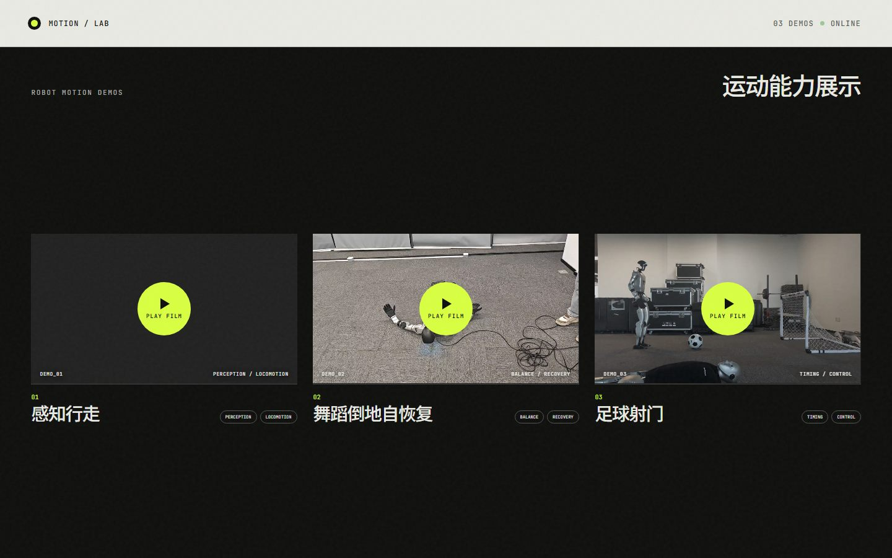

# Robot Motion Demo

感知行走、舞蹈倒地自恢复与足球射门的机器人运动能力展示。

### [点击进入在线演示 →](https://zsh-apas.github.io/robot-motion-demo/)

## 展示内容

- **感知行走** — Perception / Locomotion
- **舞蹈倒地自恢复** — Balance / Recovery
- **足球射门** — Timing / Control

> 点击上方预览图即可打开完整网页并播放演示视频。
